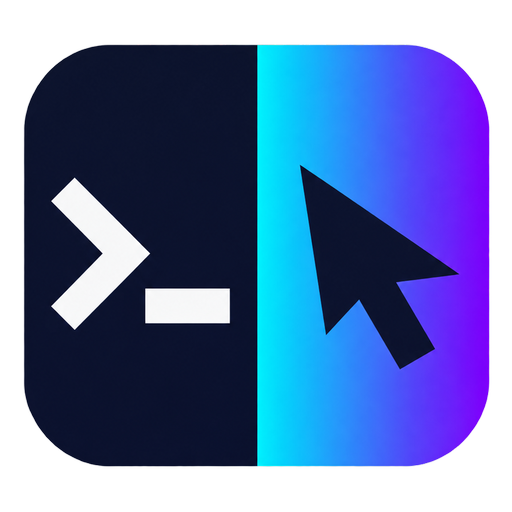

<p align="center">
  
</p>

<h1 align="center">chrome-pane</h1>

<p align="center">
  <b>Your own Chrome in a terminal pane.</b><br>
  The tabs and logins you already have, beside the agent that needs them.
</p>

<p align="center">
  
  
  
  
  
</p>

<p align="center">
  <a href="#what-it-is-for">What it is for</a> ·
  <a href="#see-it-work">See it work</a> ·
  <a href="#how-it-compares">How it compares</a> ·
  <a href="#install">Install</a> ·
  <a href="#for-agents">For agents</a> ·
  <a href="#security">Security</a>
</p>

![A Herdr window. In the middle, Claude Code at work on "Speed up the checkout page". To its right, the Chrome pane: its header has back, forward and reload buttons, the number of Chrome's tabs and the page's address in a field, and under it is the checkout page of a made-up tea shop, drawn as in a browser, with the order's total, a form filled in with a name, an email, an address and a city, the delivery set to Express and a ticked gift-wrap box. The sessions sidebar on the left lists the pane as "Checkout · Acme Shop" with Chrome's icon, among the agents at work](docs/media/preview.png)

<p align="center"><sub>In <a href="https://herdr.dev">Herdr</a>, the pane opens beside the agent that asked for it and is listed with the agents. It opens beside the agent in <a href="#see-it-work">Rex and Tern</a> too. The shop, the sessions and the people in these pictures are made up.</sub></p>

The page you want an agent's help with is usually behind a login you already have: the admin
panel, the cloud console, the ticket, the order you are in the middle of. Terminal browsers and
agent browsers start a browser of their own, signed in to nothing. chrome-pane connects to the
Chrome you use, through the remote debugging Chrome itself offers and asks you to allow, and
shows one of its tabs where you and your agents already are. You see the page and use it with
the mouse and the keyboard; the agent beside you drives the same tab with short text commands,
and you watch it happen.

## What it is for

- **Work on a page behind your login.** The agent acts on the tab where you are signed in. No
  password handed over, no cookies exported, no second sign-in, no second factor to pass again.
- **Do a chore together.** You sign in and get past the captcha, the agent fills in the forty
  rows, you look it over and press the last button. The pane's bar says what the agent is doing
  while it does it, and your mouse and keys work at all times.
- **See what the agent built.** It opens `localhost:3000` beside itself and clicks through the
  flow it just changed. You watch the page instead of reading a report about it.
- **Give an agent a page to read.** `read`, `find` and `read --table` hand over a page's text, a
  match or a table for a few hundred tokens: the docs behind your company's sign-in, a
  dashboard, a list of orders.
- **Stay in the terminal.** A reference page, a pull request or a build's log next to the code,
  in a split, without moving to another window.
- **Use the Chrome of another computer.** Chrome runs on the desktop under the desk; you sit at
  the laptop, where Herdr shows the desktop's sessions. The pane comes along with them.

## See it work

**An agent drives, you watch.** It asks for the page as text, acts on a control by its ref, and
is told only what changed.

![A shell on the left, the Chrome pane on the right. "chrome-pane open http://acme.test/checkout/" opens the pane with the shop's checkout and prints the page's controls, each with a ref. The pane's header says what the agent does, "Agent: fill e2 Sam Rivera", where the page's address was. "chrome-pane fill e2 Sam Rivera" writes the name into the form and prints the one line that changed. "chrome-pane select e6 Express, next day" changes the delivery and the order's total. "chrome-pane click" on Continue to payment prints the page's new message: Still needed: email, address, city](docs/media/demo.gif)

**You drive.** It is a browser: click, scroll, type, paste, go back, pick another of Chrome's
tabs, type an address.


**In Herdr, the app draws the controls.** The pane's header has the buttons and the address,
and Chrome's tabs are a list over the window ([how](#in-a-multiplexer)).

![The Herdr window, with Claude Code on the left and the Chrome pane on the right. The pane's header has back, forward and reload buttons, a button with the number of tabs, 3, and the address acme.test/checkout with the page's title. Over the window, a list: a field that says "Find a tab, or type an address" and "3 tabs", then Chrome's three tabs, each with a coloured tile, its title and its address (the shop's front page, "Your orders" and the checkout, which is marked "In this pane"), a row "New tab", and the keys: move, Enter show, Ctrl+D close tab, Esc leave](docs/media/tabs-list.png)

**In Rex and in Tern.** The same commands, typed in a shell of each. The pane opens to the
right of the shell, in the same tab, and nothing has to be set up for it: chrome-pane asks Rex
or Tern for the split itself.

![A Rex window. On the left, a shell where "chrome-pane open http://acme.test/checkout/" printed the page's controls; a "chrome-pane snapshot" lists the whole form, then "chrome-pane fill e2 Sam Rivera" and "chrome-pane select e6 Express, next day" each print what changed, the new delivery price and total among it. On the right, a pane labelled Chrome shows the shop's checkout with the name filled in, Express delivery picked and a total of 59 euros, under a bar that says "Agent: select e6 Express, next day"](docs/media/rex.png)


## Why chrome-pane

| | |
| --- | --- |
| **Your real Chrome** | No copied profile, no exported cookies, no extension. Chrome asks you once per start whether to allow the connection. |
| **A browser in the pane** | The page is drawn pixel for pixel with the kitty graphics protocol, at the pane's size, and follows it when you resize. |
| **Agents read text, not pictures** | `chrome-pane snapshot` is the page's controls as a few lines, each with a ref. An action answers with only what changed. On the checkout above, the whole page is 710 characters, roughly 200 tokens, and filling a field answers with 61. A picture of the same view is about 700 tokens (the pane in these pictures shows 577 × 940 pixels of page; a bigger pane costs more), and an agent that works from pictures needs a new one after every step. |
| **You stay in charge** | The pane's bar says what an agent is doing while it does it. The agent commands refuse to type into password, code and card fields, and open only web addresses. |
| **At home in your multiplexer** | In Herdr, Rex and Tern the pane opens to the right of the agent that asked for it, in the same tab, under the page's title, and leaves the keyboard with the agent. Each one is asked in its own words ([how](#in-a-multiplexer)). Anywhere else it is a program for any terminal that draws kitty graphics. |
| **From another computer** | The viewer sends only the cells of the picture that changed, at the pace each screen takes them. |
| **Nothing to build** | Node and nothing else: no dependencies, no browser download, no extension. |

## How it compares

Checked in November 2026, with terminal-browser 0.16.1 to 0.16.3 and Ardia 0.2.48. All of them move
fast: look again before you decide.

| | chrome-pane | [terminal-browser](https://github.com/zenbu-labs/terminal-browser) | [Ardia](https://github.com/mantrakp04/ardia) | A browser the agent starts (Playwright, agent-browser) |
| --- | --- | --- | --- | --- |
| **The browser** | The Chrome you already use | Its own, built on Electron | Its own: a Chromium browser for the Mac | Its own |
| **Your logins** | Already there | Sign in again in its profile. Importing Chrome's is proposed, not merged ([#57](https://github.com/zenbu-labs/terminal-browser/pull/57), [#63](https://github.com/zenbu-labs/terminal-browser/pull/63), [#237](https://github.com/zenbu-labs/terminal-browser/pull/237)) | Ardia's: yours if Ardia is your daily browser | None, until you sign in again or bring cookies over |
| **Where you see the page** | A terminal pane | A terminal pane | Ardia's window | Often nowhere: headless |
| **In Herdr** | A pane of the agent's tab, listed with the agents | The page area stays blank ([#291](https://github.com/zenbu-labs/terminal-browser/issues/291)) | A window outside Herdr | No pane |
| **From another computer** | Yes, with the terminal | Not tried | No | It runs there, unseen |
| **What an agent runs** | `chrome-pane click e12`: text in, a few lines out | agent-browser's commands | agent-browser's commands, as `ardia browse` | Its own tools; many answer with a screenshot or the whole page each step |
| **What it installs** | A link to a Node script | An Electron app | A Mac app | A browser download |

**Why not terminal-browser?** It is the same idea, a real browser in a terminal pane, and the
better choice when you want a browser that stands on its own. It is a browser of its own,
though: every site asks you to sign in again. And in the Herdr app its page stayed blank, and
it took the pane for Ghostty.

**Why not Ardia?** If Ardia is the browser you live in, its `ardia browse` already gives agents
your tabs and logins, and you don't need this. It is a window of its own, on the Mac you sit
at: not a pane beside the agent, and not something another computer's terminal can show.

**Why not a browser the agent starts?** For a public page, or work that should not touch your
accounts, that is the right tool: it is isolated, and it runs with nobody watching. It is the
wrong one for the page you are signed in to. Chrome's own DevTools MCP server can attach to
your running Chrome through the same switch chrome-pane uses; it gives an agent tools, not you
a pane.

### Measured

One headless Claude Code (Opus 5.5 at low effort) does eight browser tasks with one tool at a
time, three times each: a form, a search across pages, a report that takes seconds to come, a
confirm dialog, a long page, a table over three pages, controls made of `<div>`s. The site is a
made-up shop on the same Mac, and it checks the outcome itself. Medians of a run, on
25 November 2026:

| | Passed | Time | Input tokens | Model calls | Cost |
| --- | ---: | ---: | ---: | ---: | ---: |
| **chrome-pane** | 24/24 | 7.8 s | 22.7 k | 3 | $0.030 |
| agent-browser 0.44 | 24/24 | 9.8 s | 50.2 k | 4 | $0.039 |
| terminal-browser 0.16.3 | 24/24 | 11.3 s | 46.5 k | 5 | $0.047 |
| Claude in Chrome | 23/24 | 24.4 s | 66.1 k | 6 | $0.123 |
| cua-driver 0.55 | 24/24 | 36.4 s | 255.6 k | 13 | $0.285 |

Read it with these in mind:

- It is 24 runs a tool, and not one sitting. agent-browser ran side by side with chrome-pane
  (the two rows above). terminal-browser ran with it in Rex, where chrome-pane took 8.6 s.
  Claude in Chrome and cua ran four hours earlier, beside a chrome-pane that still took
  11.5 s and 36 k tokens.
- chrome-pane and Claude in Chrome work in the Chrome that is already running. The other three
  start a browser of their own in every run, and that start is in their time.
- Most of the difference is model calls: every one costs about 1.4 s and 6.7 k tokens before
  the tool has done anything. A chrome-pane action waits for what it started and answers with
  the outcome, so the agent does not look again. On the report that takes about 4 s to come,
  chrome-pane is done in 11 s and agent-browser and terminal-browser in 33 to 38 s.
- The shop answers at once. Made to answer 150 ms late, as a real server does, chrome-pane
  took 8.7 s, with the same calls and tokens.

[bench/README.md](bench/README.md) has the tasks, what each tool was given, every figure and
how to run it yourself.

chrome-pane is the one to pick when the browser has to be the Chrome you are signed in to, and
you want to see it where your agents are. It is not the one for unattended scraping, for an
agent you would not trust in your accounts ([Security](#security)), for video and sound, or
for Windows.

## What you need

- **Chrome 144 or newer** (or another Chromium browser that has
  `chrome://inspect/#remote-debugging`).
- **Node 22 or newer.**
- **A terminal that draws pictures with the kitty graphics protocol** and reports the mouse in
  pixels: [Herdr](https://herdr.dev), Rex, Tern, Ghostty, kitty.
- macOS. On Linux the unit tests pass and the browsers' folders are known, but it has not been
  used there yet. Windows is not supported.

## Install

**1. Check Node and Chrome.** `node --version` says 22 or more. Chrome's version is in
`chrome://version`: 144 or more.

**2. Clone it and run the installer**, from wherever you keep code. The clone is what runs:
keep it where it is.

```sh
git clone https://github.com/jeffarese/chrome-pane && cd chrome-pane && ./install.sh
```

The installer:

- links `~/.local/bin/chrome-pane` to the clone (`CHROME_PANE_BIN=<folder> ./install.sh` puts
  the link in another folder);
- gives the Herdr app on this computer the pane's name and icon, and a pane header that draws
  Chrome's controls ([how to use it](#in-a-multiplexer)), if Herdr is installed;
- links the agents' skill where Claude Code and Codex look for skills ([the skill](#for-agents)).

If it ends with "Add ~/.local/bin to your PATH", do that in your shell's startup file (for zsh,
`export PATH="$HOME/.local/bin:$PATH"` in `~/.zshrc`) and open a new terminal. An agent whose
PATH is fixed in its own settings (Claude Code's `env.PATH`, for one) needs that folder in it
too, or it is told `chrome-pane: command not found`.

**3. Turn on remote debugging in Chrome**, once: open `chrome://inspect/#remote-debugging` and
switch it on.

**4. Try it.** In a terminal:

```sh
chrome-pane tabs                 # lists Chrome's tabs
chrome-pane example.com          # shows a new tab at example.com in this terminal; Ctrl+Q quits
```

The first time, **Chrome asks you to allow the connection**: accept it, on the computer Chrome
runs on. chrome-pane keeps that one connection open until Chrome quits, so Chrome asks once
per start. `chrome-pane stop` ends it.

Then ask an agent in Herdr, Rex or Tern to open a page in the browser pane: the pane opens to
the right of the agent. Or type `chrome-pane --pane example.com` there yourself.

### What each terminal needs

| | |
| --- | --- |
| **[Herdr](https://herdr.dev)** | Nothing more: the installer gave the Herdr app the pane's name and icon. If you install Herdr later, run `chrome-pane herdr`. To watch from another computer, see [From another computer](#from-another-computer). |
| **Rex** | Nothing. chrome-pane opens the pane with Rex's own `rex` command, which it finds through what Rex gives its panes (`REX_BIN_DIR`), then on the PATH. |
| **Tern** | Nothing. chrome-pane opens the pane with Tern's own `tern` command, which it finds through what Tern gives its panes (`TERN_EXE`), then on the PATH and in `/Applications/Tern.app`. |
| **Ghostty, kitty** | Nothing. There is no pane to open for you: run `chrome-pane` in the split you want it in. |

### For your agents

The installer links `skills/chrome-pane` into `~/.claude/skills`, `~/.agents/skills` and
`~/.codex/skills`, for each of `~/.claude`, `~/.agents` and `~/.codex` that exists. An agent you
install later gets it with `chrome-pane skill install`. For any other agent, `chrome-pane skill`
prints the skill, to paste into its instructions. Codex has to run the commands outside its
sandbox, which blocks unix sockets.

### Update and remove

`git pull` in the clone updates it: the link and the skill point into the clone. If you move the
clone, run `./install.sh` again from its new place. `./install.sh --remove` takes it all out: the
link, Herdr's name, icon, pane header and list of tabs, and the skill.

### When it does not work

| It says | What to do |
| --- | --- |
| `chrome-pane: command not found` | `~/.local/bin` is not on that PATH: the shell's, or the agent's (step 2). |
| `node 22 or newer is needed`, or `Node 22 or newer is needed, and this is Node …` | Install Node 22 or newer, or name one with `CHROME_PANE_NODE=/path/to/node`. |
| `Chrome has remote debugging off` | Step 3. With Chrome running. |
| `Waiting for Chrome: accept its “Allow remote debugging?” prompt`, or an agent's `Chrome has not allowed the connection yet` | Chrome's prompt is open on the computer Chrome runs on, perhaps behind other windows: accept it. |
| `There is no Chrome pane, and this terminal is not one of Herdr, Rex or Tern` | The agent runs outside Herdr, Rex and Tern. Run `chrome-pane` in a terminal first; the agent's commands then act on that pane. |
| `Rex did not open the pane: rex was not found` (or Tern's) | The agent runs with an environment that lost what its pane was given: start it from a Rex or Tern pane, or put `rex` or `tern` on its PATH. |

## Use

```sh
chrome-pane                      # pick one of Chrome's open tabs
chrome-pane example.com          # a new tab at that address
chrome-pane --tab github         # the open tab whose title or address has "github"
chrome-pane tabs                 # list the tabs
```

| Where you run it | What happens |
| --- | --- |
| In a terminal | The tab is shown in that terminal. |
| From a program with no terminal (an agent) inside Herdr, Rex or Tern, or with `--pane` | It opens as a new pane, to the right, of the tab it was called from. |

| Key | |
| --- | --- |
| **Ctrl+T** | The list of Chrome's tabs: show another, open a new one, close one (it asks first) |
| **Ctrl+L** | Type an address, or words to search for |
| **Ctrl+R** | Reload. On the answer to a form you sent (a payment, an order) it asks first: a reload sends the form again |
| **Alt+←**, **Alt+→** | Back, forward. In a field you are typing in, they move by a word instead |
| **Ctrl+A**, **Ctrl+C**, **Ctrl+X**, **Ctrl+V**, **Ctrl+Z** | Select all, copy, cut, paste and undo in the page. On a Mac too, where Chrome has them on Cmd, which a terminal keeps for itself |
| **Ctrl+Q** | Quit the viewer. The tab stays open in Chrome |

Everything else, and the mouse, goes to the page. Copy and paste use the clipboard of the
computer Chrome runs on; your terminal's own paste types into the page from yours. A window
the page opens (a sign-in, a link in a new tab) is shown in its place, and the pane returns to
the page when that window closes. `chrome-pane --help` lists the options.

### The bar

The row above the page is the browser's toolbar, in your terminal's own colours:

```
 ‹  ›  ↻   example.com/orders/1042  ·  Order 1042 — Acme Shop            3 tabs  ^L address · ^T tabs · ^Q quit
```

- `‹`, `›` and `↻` take clicks. They are dim when there is nowhere to go back or forward to,
  and `↻` is `✕` (stop) while the page loads. The mouse over one says what it does.
- The address is a field: a click or Ctrl+L selects it, as in a browser, so typing replaces it
  and an arrow edits it. Enter goes, Esc leaves it. Words that are no address are searched for.
- `3 tabs` opens the list of Chrome's tabs.
- What the page asks takes clicks too: a dialog has `OK` and `Cancel`, a reload that would send
  a form again `Send it again` and `Leave it`.
- A narrow pane keeps the buttons and the address, and drops the key hints first.

### Without the pane

The bar can be read and used with no pane to look at or click in: from a script, another
program, or a multiplexer's own toolbar.

```sh
chrome-pane bar                       # what the bar says, as JSON
chrome-pane bar go example.com        # one of its actions
chrome-pane bar --in t4c2 back        # the pane of another terminal, or of a viewer's pid
```

```json
{ "terminal": "t4c2", "v": 1, "pid": 4242, "native": false, "own": false, "focus": 0, "pick": 0,
  "tab": "1CEDB4…", "mode": "page", "url": "https://example.com/", "title": "Example Domain",
  "loading": false, "back": true, "fwd": false, "tabs": 3, "agent": null, "dialog": null,
  "resend": false, "hidden": false, "notice": null }
```

The actions are those of the bar: `back`, `forward`, `reload`, `stop`, `go <address>`, `tabs`,
`page`, `front`, `address`, and the answers `dialog-ok`, `dialog-cancel`, `resend-yes` and
`resend-no`. Three more are for Chrome's other tabs, by the ids `chrome-pane tabs --json`
gives: `show <id>` shows that tab in the pane, `close-tab <id>` closes it in Chrome, and
`new [address]` opens one. The viewer does an action as soon as it is asked; one it has not taken within 15
seconds is dropped, not done late. These are the person's controls. An agent has
[its own commands](#for-agents), which also say what the page did.

### In a multiplexer

In a terminal with panes, chrome-pane opens its own: beside whoever asked, in the same tab, and
it asks the multiplexer in its own words. A pane an agent opens leaves the keyboard with the
agent. A later command from that tab finds the pane through the multiplexer and uses it instead
of opening a second one.

| | How the pane opens | What it uses |
| --- | --- | --- |
| **[Herdr](https://herdr.dev)** | `hc run`, with the space and tab of the terminal that asked | The pane is listed with the agents as Chrome, with the page's title and its own icon, and shows on every computer looking at that tab. |
| **Rex** | `rex split`, to the right of the block that asked | The block is labelled Chrome, shows the page's title and tells Rex its program is `chrome`. It closes when the viewer quits. `--pane` typed by you gets the keyboard. |
| **Tern** | `tern split`, to the right of the block that asked | The block's title is the page's. It closes when the viewer quits. `--pane` typed by you gets the keyboard. |

**Herdr's own pane header can draw the controls**, as real buttons and a real text field, and
the viewer then draws no bar: the page has the whole pane.

Back, forward, reload and the tabs are on the left, then the address, which is a field to
type in. The tabs button, or Ctrl+T in the pane, drops a list of Chrome's tabs over the window:
type to find one, ↑↓ and Enter (or a click) to show it in the pane, × to close it in Chrome (it
asks first), and what you typed opens in a new tab when it is no tab's name.

`chrome-pane herdr` (the installer runs it) puts a pane header named `chrome-pane` and the
list of tabs (`chrome-pane-tabs`) in the Herdr app's mods. A layout uses the header as its
pane header:

```json
{ "tab": "active", "pane": { "header": { "content": { "mod": "chrome-pane" } } } }
```

It is Herdr's own header for every other pane. If you have a header mod of your own,
`chrome-pane herdr --into <mod>` puts the controls (`chrome-bar.js` and its icons) in that mod's
folder; the top of `chrome-bar.js` has the four lines its `main.js` needs. Either way:

- The viewer says what its bar shows in a label on its terminal (`chrome-pane.bar`), and the
  header and the list act through `chrome-pane bar` and `chrome-pane tabs --json`, on the
  computer the viewer runs on.
- The header tells the viewer it draws the controls, and goes on telling it. A viewer that is
  not told for 80 seconds (the header was removed, the window closed) puts its own bar back.
- `chrome-pane --bar` keeps the viewer's own bar in that pane.

Rex has no place for a program's controls in a block's header, so the bar is the viewer's own
there; so it is in Tern, whose plugins could draw one, which chrome-pane does not do yet.

Which one it is in, chrome-pane reads from what each gives its terminals (`HC_TERMINAL_ID`,
`REX_BLOCK`, `TERN_PANE`). With one inside another, the terminal's own `TERM_PROGRAM` decides;
`CHROME_PANE_HOST=herdr|rex|tern` says it yourself, and `none` never opens a pane.

In any other terminal that draws kitty graphics (Ghostty, kitty), run `chrome-pane` in the
split you want it in.

## For agents

An agent does not look at the picture. It asks for the page as text, acts on a control by its
ref, and is told only what changed, while you watch the same tab in the pane and can take over
at any moment ([the film above](#see-it-work)).

```sh
chrome-pane open example.com/login   # opens the pane if this tab has none; prints the page
```

```
Sign in
https://example.com/login
view 800x680 at 0 of 680 px · 4 of 4 controls in view (0 above, 0 below)
e30 main
 e31 h1 "Sign in"
 e12 textbox "Email"
 e13 textbox "Password"
 e14 button "Continue"
 e15 link "Forgot your password?"
```

```sh
chrome-pane fill e12 ada@example.com
```

```
filled e12 "Email"
~ e12 textbox "Email" ="ada@example.com"
```

| Command | What it prints |
| --- | --- |
| `open <url>`, `back`, `forward`, `reload` | The page it lands on. `reload` is refused on the answer to a sent form, which it would send again, unless it is `reload --resend`. |
| `snapshot` | The controls in view under their sections and headings, each with a ref. `--all` the whole page, `--in <ref>` one part, `--text` with the text, `--urls` with the links' addresses. |
| `find <text>` | The elements that have it, and whether each is in view, above or below. A cell of a table comes with its row, a named section with the controls in it, and look-alikes with what each is under. |
| `read [ref\|css]` | The main text, or one part's. `--table` a table as rows. |
| `click`, `hover`, `check`, `uncheck <ref>`; `fill <ref> <text>`; `select <ref> <option>`; `type <text>`; `press <keys>`; `scroll [down\|up\|top\|bottom\|ref]` | What it did, then what changed in the page's controls, messages and text: `~` changed, `-` gone, `+` new. A new page prints its snapshot. In place of a ref, the name of a control (`click "Next"`, `fill "Email" ada@example.com`) when no other control has it. |
| `wait <text>` | When it is on the page. Or `--gone <text>`, `--url <part>`, `--idle`; `--timeout <s>`. |
| `batch` | Several actions, one a line on its input, and one answer. With names in place of refs it goes on from one page to the next. |
| `shot` | The path of a picture of the view, and what it costs to look at. `--out <new .jpg file>` puts it elsewhere. |
| `dialog accept\|dismiss` | Answers the page's alert or question, and prints what the page did with the answer: the outcome of the action that made it ask. |
| `eval <js>` | The value. Not among the commands the skill lets an agent run unasked. |
| `done` | Nothing: the pane's bar stops saying an agent is at work. |

An agent's command acts on the tab shown by the pane of the Herdr, Rex or Tern tab it runs in.
While it does, the pane's bar says what it is doing.

A ref is a letter and Chrome's own number for the element: it stays good for as long as the
element lives, and the letter changes with every page loaded, so a ref from an earlier page is
refused (with the page there is now) instead of landing on something else. A name is looked up
when the action runs, and waited for a moment if the page does not have it yet. A name that two
controls have is refused, with the list of them and what each is under, instead of acting on a
guess; and a click takes a control's whole name ("Delete" is not "Delete account"), while a
field, a list or a checkbox may be meant by a part of its name.

An action is over when the page has taken it in: the page it loads, the answers it asked the
network for (a search, a save; for 8 seconds at most) and the changes those make. So what an
action prints is its outcome, and a click on "Generate report" comes back with the report.

Controls that a page makes of plain elements, with no role or name for assistive tools, are
listed as `clickable`: they are known by the click they listen for, or by the hand the pointer
turns into over them.

What the commands refuse: any address that is not http or https; writing into a password,
one-time-code or card field with `fill`, `type` or `press` (you type those in the pane), or
into a field inside another site's frame, where a payment form usually is; printing such a
field's value; writing a picture over a file. They know such a field by its type, its
`autocomplete` or its name, so a page that hides what a field is can get past them, and `eval`
runs whatever JavaScript it is given: these are limits for an agent that means well, not a
wall. [SECURITY.md](SECURITY.md) says what is and is not protected.

**The skill** (`skills/chrome-pane`) tells an agent all of this. `./install.sh` gives it to
Claude Code and Codex, and `chrome-pane skill` prints it for any other agent ([how](#for-your-agents)).

## From another computer

Chrome runs on one computer; you sit at another whose Herdr shows the first one's terminals. Run
`chrome-pane` in a session on the first one (or let its agent run it): the viewer is a terminal
there, next to Chrome, and Herdr shows it on the computer you are at like any other pane.

On the computer you watch from, only Herdr's name and icon for the pane are needed, and the
pane header if you use it (the Herdr app that draws the window decides them): clone this there
and run `bin/chrome-pane herdr`.

What travels is pictures, through Herdr's connection, so the viewer sends as little of them as
it can: only what changed, half the pixels while the whole page moves, no more than each screen
has taken, and again when a picture went missing.

<details>
<summary>How, in detail</summary>
<br>

- **Only what changed.** Chrome hands over every frame whole. The viewer compares it with what
  is on screen and sends the cells that differ as a small picture laid over the big one: a row
  lighting up under the mouse in a large Retina pane is 1 to 90 KB instead of 1.7 MB.
  `--whole` turns that off.
- **Half the pixels while the whole page moves.** A scroll or a film changes everything, so by
  default (`--quality auto`) the viewer asks for half-size frames then, and for the full-size
  one again when the page rests. `--quality fast` never asks for full size; `--quality sharp`
  always does.
- **No more than each screen has taken.** After a picture the viewer asks a question that
  every screen showing the pane answers once it has drawn it, and sends the next picture when
  they all have: the pace is that of the slowest link, whatever it is. Herdr keeps a few
  megabytes for a screen that is behind and then drops them, so a picture bigger than that
  is not sent whole to a screen on another computer: the page stays at half size there. A
  terminal that answers nothing gets 3 MB a second (`--rate <MB a second>`).
- **A picture that went missing is sent again.** Herdr sends a screen the pane's text without
  its pictures when the screen connects, comes back, or fell behind. Every few seconds the
  viewer asks the screens whether they still have the page's picture, and sends the page
  again to one that says no.

A frame equal to the last one is not sent. When Chrome's window is on a screen of one pixel a
point, full size has no more pixels than half, and the picture stays as soft as that screen is.

</details>

## Security

The connection chrome-pane holds can read and drive every tab of the Chrome you are signed in
with. In short:

- Chrome asks you before it allows the connection, and chrome-pane never starts Chrome with a
  debugging port of its own.
- Nothing listens on the network: the connection is shared over one unix socket that only your
  user can open.
- A reload of the answer to a sent form sends the form again, and Chrome does not ask when the
  reload comes through this connection. So the pane asks you, and an agent's `reload` refuses.
- The limits on agents (web addresses only, no secrets, the pane's tab only) are guidance for
  well-behaved agents, not a sandbox, and a page's text can try to instruct an agent that reads
  it. Watch the pane.

[SECURITY.md](SECURITY.md) has the whole of it, and how to report a problem.

## How it works


- **Bridge** (`src/bridge.mjs`). Holds the one connection Chrome approved and shares it: viewers
  send DevTools messages over `~/.local/state/chrome-pane/bridge.sock` (your user only). A viewer
  starts it when there is none. When a viewer goes, the bridge detaches what it attached, which
  gives the tab its own size back.
- **Viewer** (`src/viewer.mjs`). Asks Chrome for a screencast of the tab, sized to the pane, and
  draws each frame with the kitty graphics protocol. Mouse reports and keys from the terminal
  become DevTools input events. It reports itself as `chrome` (OSC 7501) with the page's title,
  which is what lists it with the agents in Herdr and what Rex shows as the pane's program.
- **Pane** (`src/hosts.mjs`). One small adapter for each multiplexer: how to tell a terminal is
  inside it, how to open the viewer beside the caller, and which panes share the caller's tab.
  In Herdr a terminal labelled with a space and a tab shows up in that tab on every Herdr window
  looking at its machine, so the viewer is started with `hc run` and the labels of the terminal
  it was called from. In Rex and Tern it is a split of the caller's block.
- **Agent commands** (`src/agent.mjs`). Each is a process of its own that attaches a second
  DevTools session to the pane's tab, through the bridge, and detaches when done. It reads the
  accessibility tree and the elements' boxes, and clicks with the same input events the viewer
  sends. Viewers and commands tell each other what they need through small files in the state
  folder (`src/panes.mjs`): which tab a pane shows, what an agent is doing to it, the dialog a
  page stopped at. The viewer answers dialogs for agents, because Chrome lets only a session
  that saw a dialog open answer it.

## Limits

- **It is the real tab.** While a viewer shows it, the page has the pane's size, in Chrome too
  (`--mirror` keeps Chrome's size and scales the picture instead).
- **Chrome draws only the tab in front** of a window it can see. A tab opened here is brought to
  the front in Chrome once; if you later switch tabs in Chrome, the viewer pauses and says so,
  and a click or key in it brings the tab forward again (`--no-front` never does). Two viewers on
  two tabs of the same Chrome window take turns for the same reason.
- Chrome may show that it is being debugged while the bridge is connected.
- Native menus (a `<select>`'s list, the file picker, right-click menus) are drawn by the
  system, not the page, so they don't appear. An agent's `select` works all the same. In Herdr,
  right-click opens Herdr's own menu.
- In Rex, a click on a pane that does not have the keyboard gives it the keyboard: the page gets
  the next one.
- Cmd shortcuts belong to the terminal app; Ctrl+Q, Ctrl+T, Ctrl+L and Ctrl+R belong to the
  viewer. No sound, and video is a slideshow.
- An agent's `snapshot` lists what the page marks as a control. Something clickable that is only
  a styled `<div>` is not in it: `find <text>` gives its ref.

## Develop

```sh
npm test                 # the input parser, keys, layout, pictures and the agent commands' arguments
sh test/e2e/run.sh       # the viewer and an agent's commands against a headless Chrome with a throwaway profile
node bench/run.mjs       # agents doing browser tasks with chrome-pane and four other tools: time, tokens, failures
node bench/micro.mjs     # chrome-pane's commands alone, with no model: how long each takes, how much it prints
```

[bench/README.md](bench/README.md) says what the benchmark measures and how to read it.

The end-to-end tests start their own headless Chrome with an empty profile and never touch
yours.

`CHROME_PANE_TRACE=<file>` makes a viewer write the sizes and timings of the pictures it sends.
`CHROME_PANE_DEBUG=<file>` makes it write everything it receives, **every key typed included**:
for a test page only.

`docs/demo` has the made-up shop and the scripts behind the pictures and films above.

## License

[MIT](LICENSE). Chrome is a trademark of Google LLC; chrome-pane is not affiliated with or
endorsed by Google. The pane's icon in Herdr is taken from the Chrome installed on your
computer: this repository carries none of Google's artwork. chrome-pane's own logo was made
for it with OpenAI's image generation. terminal-browser, Ardia, Playwright and agent-browser
belong to their authors and are named here only to compare.
